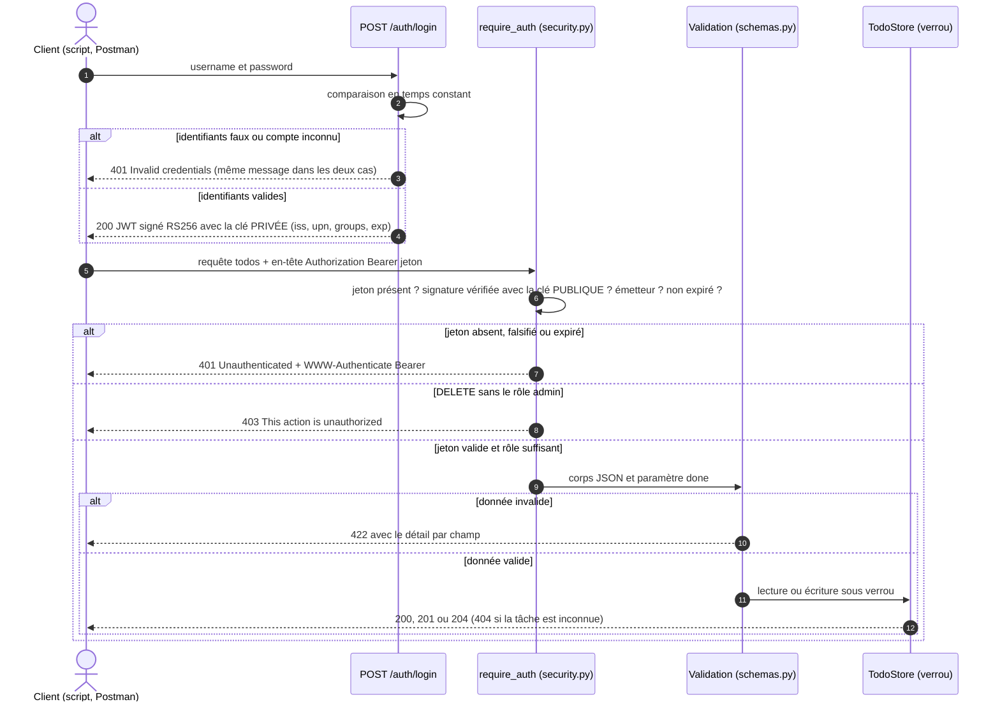
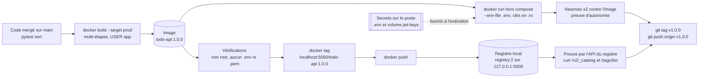

# Schémas de la soutenance

GitHub et GitLab affichent ces schémas directement. Pour une diapositive : copier le bloc dans https://mermaid.live
puis exporter en PNG ou SVG.

## 1. Les étapes de sécurisation

Chaque requête passe des contrôles dans cet ordre ; au premier qui échoue, la requête s'arrête et le client reçoit
une erreur JSON uniforme `{ "message": "..." }`, sans aucune trace technique.

Autour de ce parcours :

| Couche | Mesure | Où |
| --- | --- | --- |
| Secrets | Mots de passe dans `.env`, clés RSA dans un volume Docker : jamais dans Git, jamais dans l'image | `.gitignore`, `.dockerignore`, `scripts/check-secrets.sh` |
| Authentification | JWT RS256, durée de vie courte, algorithme imposé par le serveur (jamais `none`) | `app/security.py` |
| Autorisation | `@require_auth()` sur toutes les routes todos, `@require_auth(ROLE_ADMIN)` sur DELETE | `app/routes/todos.py` |
| Validation | Schémas marshmallow, champs inconnus ignorés (pas de *mass assignment*), booléen strict, filtre contrôlé | `app/schemas.py` |
| Erreurs | Gestion centralisée : JSON uniforme, 500 sans détail, trace uniquement dans les journaux | `app/errors.py` |
| Exécution | Conteneur sous l'utilisateur `app` (non root), code en lecture seule, API publiée sur `127.0.0.1` | `Dockerfile`, `scripts/run-prod.sh` |

## 2. La chaîne de publication

En une phrase : **on ne tague que ce qu'on a prouvé**. L'image est construite, vérifiée, publiée, lancée seule
avec ses secrets fournis de l'extérieur, testée par Newman, et seulement ensuite la version est figée par le tag Git.
